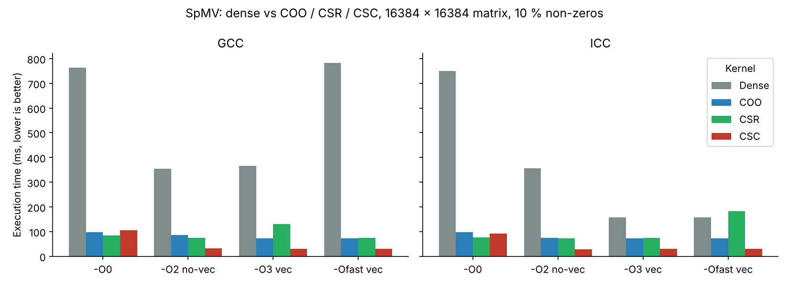

# SpMV Benchmarking

Benchmarks of **sparse matrix-vector multiplication (SpMV)** in C, comparing custom implementations against the GSL / CBLAS reference routines, across storage formats, compilers and optimization levels. Coursework from the High Performance Computing master's programme at Universidade da Coruña (2024).

## Contents

| Folder | Description |
|---|---|
| [`Task1/`](Task1) | Dense vs. sparse (CSR) matrix-vector product: custom implementations checked against `cblas_dgemv()` and `gsl_spblas_dgemv()`. |
| [`Task2/`](Task2) | Benchmark of COO, CSR and CSC formats on a 16384 × 16384 matrix (10 % non-zeros), compiled with GCC and ICC at `-O0`, `-O2` (no vectorization), `-O3` and `-Ofast`. |

## Key results (Task 2, GCC, execution time)

| Kernel | -O0 | -O2 no-vec | -O3 vec | -Ofast vec |
|---|---:|---:|---:|---:|
| Dense | 764 | 355 | 366 | 782 |
| COO | 97 | 87 | 72 | 72 |
| CSR | 85 | 74 | 131 | 74 |
| CSC | 105 | 33 | 30 | 31 |

Sparse formats are up to ~25× faster than the dense product at 10 % density; CSC benefits most from compiler optimizations. Full results (including ICC) in [`Task2/README.md`](Task2/README.md). The chart is regenerated by `scripts/make_figures.py`.



## Build and run

Requires GCC (or ICC) and the GNU Scientific Library.

```bash
sudo apt install libgsl-dev   # Debian/Ubuntu
cd Task1                      # or Task2
make
./spmv 1024 0.25              # matrix size, density of non-zeros
```

## Tech stack

C · GSL / CBLAS · GCC / ICC · Make
